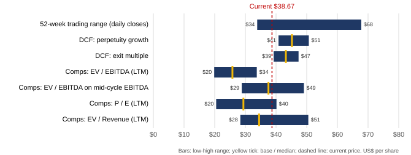

# NIKE, Inc. (NYSE: NKE): priced for a partial margin recovery

**Equity research memo, portfolio project. Draft, 2026-11-02.** Prices as of the 2026-10-30 close. US$; fiscal years end May 31 (FY2026 = year ended May 31, 2026).

| Share price | DCF fair value (Base) | Upside | Market cap | Net cash | 52-week range | Illustrative view |
|---|---|---|---|---|---|---|
| $38.67 | $43–45 (mid $44) | +12% to +17% | $57.4bn | $0.5bn | $33.87–$67.78 | Hold, positive bias |

## Thesis in three points

1. **The debate is margins, not survival.** Revenue is flat at $46.4bn (FY2026, +0.2%), but EBIT margin has fallen from 14.7% in FY2022 to 8.3%. That reflects wholesale resets, heavy discounting to clear inventory, Greater China weakness and tariffs. Nike still has net cash and A+/A2 credit ratings, and paid a $1.63-a-share dividend in FY2026.
2. **The current price implies FY2030E EBIT margin of about 9.5%.** That is well below the FY2022–24 average of 13.2%. Our Base case reaches 11.5% in FY2030E and 12.1% in FY2031E, still below pre-reset levels, and is worth $43–45 per share. Each 1pp of FY2030E margin is worth about $3.4 per share.
3. **Trough multiples understate value; normalized multiples support the price.** On LTM EBITDA, peer multiples imply only $26 a share. Applied to Nike's mid-cycle EBITDA (14.7% margin on LTM revenue), the same peer median implies $37.50. The stock is cheap only if margins recover, and the market has priced in part of that already.

## Where Nike stands

- **Top line:** Q1 FY2027 revenue was $11.2bn, down 4.3% year on year. North America wholesale grew 9.0% as partners restocked. NIKE Direct fell (North America −6.0%) as digital moved back to full price. Greater China wholesale fell 27.9%. Converse fell 31% in FY2026.
- **Profitability:** FY2026 gross margin was 42.9%. That includes a $986m IEEPA tariff refund, which roughly offset the tariffs Nike paid. Q1 FY2027 EBIT was flat at $907m.
- **Balance sheet:** at 2026-08-31, cash and short-term investments were $8.4bn and debt $7.9bn. Inventory days are about 103, against 96 in FY2024. Share buybacks have been paused since Q1 FY2026.

## Forecast and valuation

| Scenario | FY27E revenue | FY27E EBIT margin | FY27E EPS | FY31E revenue | FY31E EBIT margin | FY31E EPS | DCF: perpetuity / exit |
|---|---|---|---|---|---|---|---|
| Bull | $46.6bn | 8.8% | $2.20 | $57.2bn | 14.0% | $4.89 | $56.85 / $53.63 |
| **Base** | **$45.1bn** | **7.8%** | **$1.89** | **$52.1bn** | **12.1%** | **$3.85** | **$45.18 / $43.20** |
| Bear | $43.3bn | 6.1% | $1.44 | $45.0bn | 9.6% | $2.58 | $31.85 / $30.95 |

- **Forecast build:** revenue is built from segment and channel (wholesale and direct) growth for each geography. Gross margin is underlying margin less a tariff allowance. Working capital moves to target days by FY2028E: inventory days go from 103 to 98, and receivable days from 41 to 37, excluding the IEEPA receivable.
- **WACC 8.82%:**
  - Cost of equity 9.40% = Rf 4.94% (10-year Treasury) + adjusted beta 1.01 × ERP 4.41% (Damodaran's implied premium). Raw beta is 1.02, from 60 monthly returns against the S&P 500 TR.
  - After-tax cost of debt 4.58% (Treasury + 0.78% A2/A spread, 20% tax).
  - Weights: 88% market equity, 12% book debt.
- **DCF mechanics:**
  - Unlevered FCF, with stock-based compensation treated as a cost.
  - Mid-period discounting from 2026-10-30. The FY2027E stub (58% of the year) is discounted at 0.29 years.
  - The $684m IEEPA refund was collected in Q1, so it is already in the cash balance; it is removed from FY2027E cash flow.
- **Terminal value** is 76–77% of EV under both methods: g = 2.25% or 10.0x FY2031E EBITDA. The methods cross-check: the perpetuity value implies 10.6x EBITDA, and the exit multiple implies 1.9% growth.
- **Comparables** (adidas, PUMA, Lululemon, Deckers, On, Under Armour):
  - Peer medians: 8.2x LTM EV/EBITDA, 14.1x P/E, 1.11x EV/revenue. Nike trades at 12.4x, 18.6x and 1.24x on trough earnings, and at 8.5x mid-cycle EBITDA.
  - PUMA and Under Armour are N/M on EBITDA and P/E.
  - Lease accounting differs (IFRS vs. US GAAP). Each multiple is internally consistent, but the residual difference is not adjusted.

## Sensitivities and risks

- **WACC ±0.5pp** moves the perpetuity value to $42.0–$48.9. Terminal growth of 1.75–2.75% gives $42.6–$48.2.
- **Downside (Bear, about $31):** Greater China keeps shrinking, replacement tariffs, and margins stall below 10%.
- **Upside (Bull, about $54–57):** the wholesale and full-price reset works, and gross margin returns to about 46% by FY2031E with mid-single-digit revenue growth.
- **Other risks:**
  - Share loss to newer brands; On grew 14% year to date.
  - Inventory build: Q1 FY2027 inventory was $7.8bn.
  - FX.
  - Sustained discounting if demand stays soft.
- **Catalysts:** Q2 FY2027 results (quarter ending 2026-11-30), with Greater China and gross margin as the swing factors, and the timing of buybacks restarting.

## Conclusion

At $38.67 the market assumes only a partial margin recovery. Our Base case assumes margins recover to slightly below pre-reset levels, and gives $43–45, a 12–17% upside. Bear-case downside of about 19% is smaller than Bull-case upside of about 43%. The call rests on one variable, FY2030 margin, which we cannot verify before the next few quarters of gross margin data. That supports a positive bias rather than a high-conviction call.

*Sources: Nike 10-K FY2022–FY2026 and 10-Q Q1 FY2027 (SEC EDGAR XBRL); peer filings and IR releases; U.S. Treasury; Damodaran Online; ECB; Yahoo Finance and Nasdaq closing prices. Every input is cited in nike_model.xlsx. Portfolio exercise, not investment advice.*
